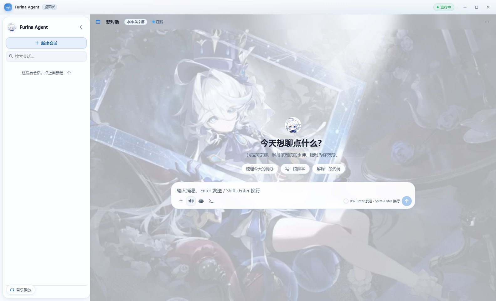
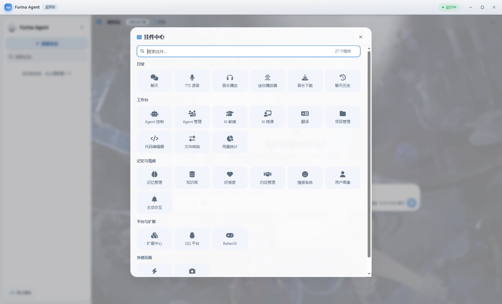
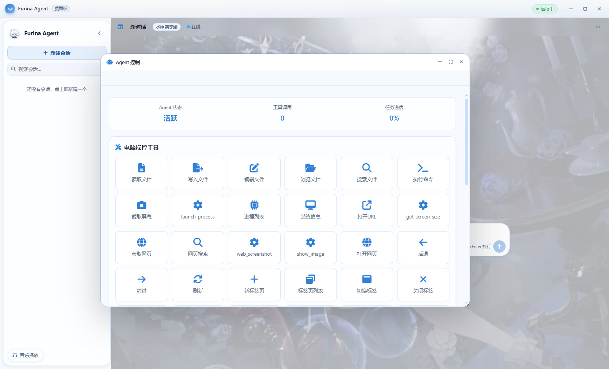
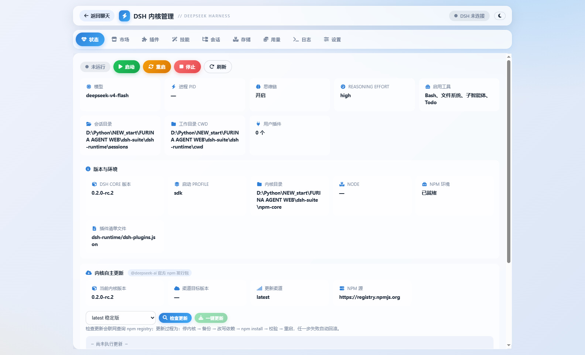
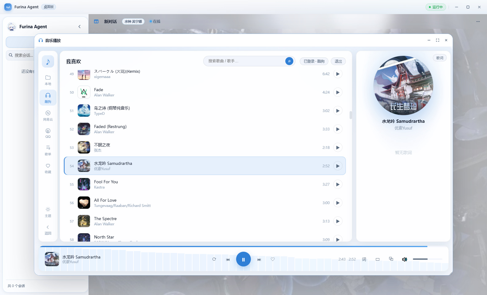
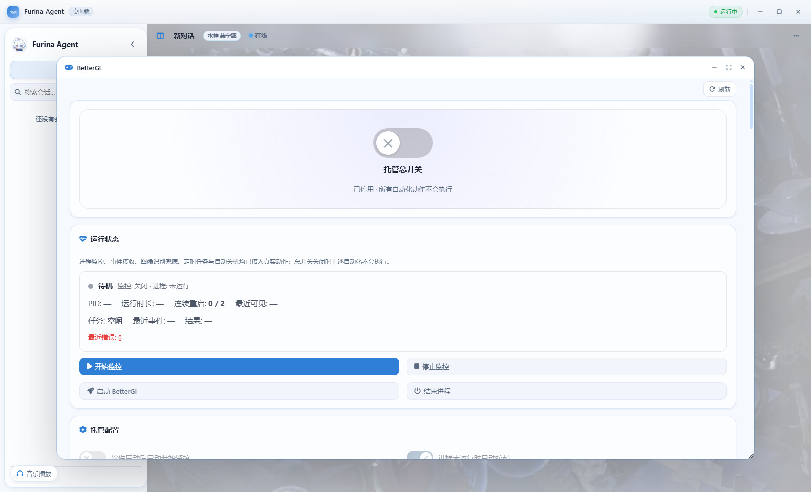
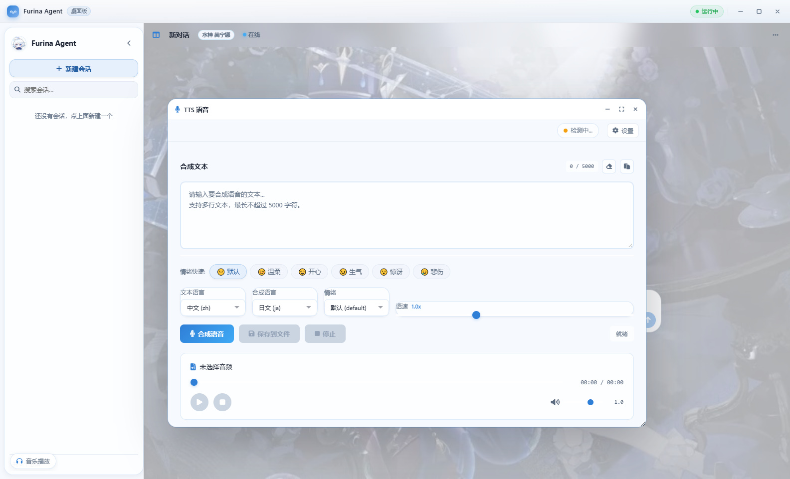
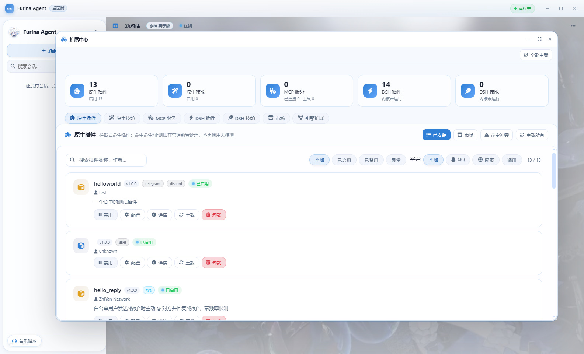
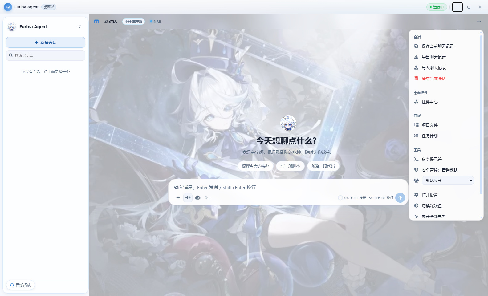

# Furina Agent Web（芙宁娜智能助手）

> 基于大语言模型的一体化 AI 对话与自动化桌面助手：pywebview 桌面壳 + FastAPI 后端 + 原生 JS 单页前端。
> 以「芙宁娜」为主题角色，集成 Agent 工具调用、思考过程可视化、记忆与情感系统、音乐播放器、截屏录屏、电脑操控、BetterGI 托管、DSH 内核等能力。


> 本项目为个人自用工具，涉及游戏自动化与第三方音乐平台的非官方接口，**请先阅读文末的「免责声明」**。

---

## 目录

- [功能特性](#功能特性)
- [界面预览](#界面预览)
- [环境要求](#环境要求)
- [快速开始](#快速开始)
- [配置说明](#配置说明)
- [打包成可执行文件](#打包成可执行文件)
- [目录结构](#目录结构)
- [模块简介](#模块简介)
- [常见问题](#常见问题)
- [数据与隐私](#数据与隐私)
- [免责声明](#免责声明)
- [许可证与致谢](#许可证与致谢)

---

## 功能特性

**对话与 Agent**

- 流式对话（SSE），支持思考过程（reasoning）实时展示、折叠、复制
- DSH（DeepSeek Harness）风格的 Agent 过程区：工具调用卡片、`IN / OUT` 详情、审批停靠栏、TODO 计划区
- 工具调用与会话一起持久化，重新打开会话可回放历史工具卡片
- 会话队列与插话（steer）、`@` 引用文件/图片、上下文占用环
- 子 Agent（subagent）与工作流编排、会话分支（fork）、文件检查点（checkpoint）与回滚
- 内置 80+ 电脑操控工具：读写文件、grep、diff、压缩包、CSV 预览、命令行、截屏、进程查看等

**记忆与人格**

- 长期记忆、知识库、用户画像、好感度、情感状态、约定管理、主动交互（定时关怀）

**多媒体与自动化**

- 音乐播放器：本地曲库 + 网易云 + 酷狗 + QQ 音乐（搜索、歌单、扫码登录、逐行/逐字歌词、队列、收藏、下载、桌面歌词浮窗、迷你播放器）
- 音乐播放器为独立页面 `/music`，可内嵌为挂件，也可弹出独立窗口后台播放
- 截屏录屏、TTS 语音合成（edge-tts / pyttsx3）、图像生成、代码执行沙箱
- BetterGI 托管：进程监控、原神自动启动/重启、图像识别（OCR + 模板匹配）、更新流程自动化、异常自愈、QQ 通知
- QQ 机器人（NapCat / 官方开放平台）、插件系统（兼容 AstrBot 插件 API）

**工程化**

- PyInstaller 多文件（onedir）打包脚本，一键产出可分发目录
- 图像识别全内存化，识别完即释放，不写截图文件
- 前端为原生 JS 单页，无构建链依赖

---

## 界面预览

> 截图来自实际运行（Windows 桌面壳，水蓝玻璃主题）。

| 主界面 · 对话 | 挂件桌面（功能菜单） |
| --- | --- |
|  |  |

| Agent 工具面板 | DSH 内核管理 |
| --- | --- |
|  |  |

| 音乐播放器（本地 / 网易云 / 酷狗 / QQ） | BetterGI 原神托管 |
| --- | --- |
|  |  |

| 语音合成（TTS） | 扩展中心 |
| --- | --- |
|  |  |

| 右上角功能菜单（会话/模型/工具入口） | |
| --- | --- |
|  | |

## 环境要求

| 项目 | 说明 |
| --- | --- |
| 操作系统 | Windows 10/11（主要开发环境）；macOS / Linux 理论可用（TTS、桌面壳依赖略有差异） |
| Python | 推荐 3.10 ~ 3.13（仓库在 3.14 上亦可运行；Win7 需 3.8.10） |
| 显示环境 | 桌面壳基于 pywebview，需要 WebView2（Win）/ WebKit（macOS）/ GTK（Linux） |
| 可选 | `playwright install chromium`（浏览器自动化）；BetterGI（游戏托管）；本地 OCR 依赖（见常见问题） |

---

## 快速开始

```bash
# 1. 克隆
git clone https://github.com/MISAKAMIYO/Furina-Agent.git
cd Furina-Agent

# 2. 安装依赖（建议虚拟环境）
python -m venv .venv
.venv\Scripts\activate        # Windows
# source .venv/bin/activate   # macOS / Linux
pip install -r requirements.txt

# 3. 首次配置：把示例配置复制成真实配置，填入你的 API Key
mkdir data
copy config.example\settings.json data\settings.json   # Windows
# cp config.example/settings.json data/settings.json   # macOS / Linux

# 4. 启动桌面版
python desktop.py
```

也可以直接双击启动脚本：

| 脚本 | 作用 |
| --- | --- |
| `start_new.bat` | 以桌面壳方式启动（推荐） |
| `start.bat` | 只启动 FastAPI 后端（浏览器访问） |
| `start_admin.bat` | 以管理员身份启动（BetterGI 托管/更新流程需要） |
| `start.sh` | macOS / Linux 启动脚本 |

启动后桌面壳会自动申请一个空闲端口并在内置浏览器中打开界面；也可手动指定端口：

```bash
python desktop.py --port 58370
```

---

## 配置说明

配置文件：`data/settings.json`（首次运行可复制 `config.example/settings.json` 修改）。

关键字段：

| 字段 | 说明 |
| --- | --- |
| `provider` / `api_url` / `model` | 模型提供方、接口地址、模型名（兼容 OpenAI 协议的服务均可） |
| `api_key` / `openrouter_api_key` | 你的 API Key，**不要提交到仓库** |
| `max_tool_iterations` | 单轮对话允许的最大工具调用轮数 |
| `agent_workspace` | Agent 可操作的工作目录（默认项目根目录） |
| `deepseek_thinking_enabled` / `deepseek_reasoning_effort` | 思考模式开关与推理强度 |
| `bettergi.*` | BetterGI 托管相关：安装路径、启动参数、健康检查、通知配置等 |

> `data/` 目录已被 `.gitignore` 忽略：里面包含 API Key、登录 token、聊天记录、歌曲等私有数据，**永远不要提交**。

---

## 打包成可执行文件

需要先安装 PyInstaller：

```bash
pip install pyinstaller
```

然后：

```bat
build.bat                     :: 双击运行，默认清理并打包
python tools\build.py --zip   :: 打包并压缩成 dist\Furina Agent.zip
python tools\build.py --check :: 只检查环境，不打包
python tools\build.py --quiet :: 精简输出（默认输出完整打包过程）
```

- 产物为**多文件（onedir）**目录：`dist/Furina Agent/`，内含 `Furina Agent.exe`、`frontend/`、`backend/`、`data/`（OCR 依赖与更新模板）。
- 打包脚本会：检查 Python/PyInstaller/spec/图标/模板/OCR → 检测程序是否在运行 → 清理 → 调用 PyInstaller（实时输出全部日志 + 心跳）→ 校验产物 → 可选压缩。
- 产物目录可整体移动，`data/` 与 exe 同级即可携带自己的配置与数据。

---

## 目录结构

```
Furina Agent Web/
├─ backend/
│  ├─ main.py                  # FastAPI 入口
│  ├─ astrbot/                 # AstrBot 插件 API 兼容层
│  └─ zhiyan_web/              # 业务包
│     ├─ agent/                # Agent 循环、工具执行、检查点
│     ├─ chat/                 # 会话、SSE 流式对话
│     ├─ core/llm/             # LLM 客户端、会话管理、消息转换
│     ├─ computer/tools/       # 电脑操控工具集
│     ├─ bettergi/             # BetterGI 托管：状态机、视觉识别、更新流程
│     ├─ music/                # 音乐：本地曲库、网易云、酷狗、QQ
│     ├─ memory/ knowledge/    # 记忆、知识库、用户画像
│     ├─ emotion/ likability/  # 情感与好感度
│     ├─ screencap/ ffmpeg/    # 截屏录屏、音视频处理
│     ├─ mcp/ plugins/ skills/ # MCP、插件、技能
│     └─ dsh/                  # DSH 内核接入
├─ frontend/                   # 原生 JS 单页前端 + 静态资源
│  ├─ index.html               # 主界面（聊天、挂件桌面）
│  ├─ music.html               # 音乐播放器（独立页 / 挂件 iframe）
│  ├─ music_mini.html          # 迷你播放器
│  └─ static/js/app.js         # 主逻辑
├─ docs/                       # 架构、模块、开发记录
├─ tools/                      # build.py 打包、gen_bgi_templates.py 模板生成
├─ config.example/             # 配置示例（密钥已清空）
├─ build_exe.spec              # PyInstaller 配置
├─ desktop.py                  # 桌面壳（pywebview + 后端线程）
└─ requirements.txt
```

---

## 模块简介

- **Agent 循环**：LLM → 工具调用 → 结果回填 → 继续推理，直到产出最终回复；支持流式事件与中断。
- **SSE 事件协议**：`thinking / reasoning / chunk / tool_call / tool_result / approval_* / todo_list / subagent_* / usage / done`，前端据此渲染过程区。
- **BetterGI 托管**：`vision.py` 负责截图 + OCR + 模板匹配（全内存），`update_flow.py` 用声明式步骤驱动「原神更新 / BetterGI 更新」，`service.py` 负责进程与健康自愈。
- **音乐**：本地文件走 `/api/music/stream`；网易云/酷狗/QQ 通过后端代理拉流（平台有 Referer/签名校验），播放器为独立页面，支持内嵌挂件与独立迷你窗。

---

## 常见问题

**Q：启动报缺少 WebView2 / 白屏？**
Windows 需安装 Microsoft Edge WebView2 Runtime（Win11 自带）。也可用 `start.bat` 只起后端，再用浏览器打开终端里打印的地址。

**Q：BetterGI 更新流程点击没反应？**
BetterGI 以管理员运行时，Windows 的 UIPI 会拦截非管理员进程的模拟点击。请用 `start_admin.bat` 或右键「以管理员身份运行」启动本程序；界面 BetterGI 页顶部也会有提权提示。

**Q：OCR 不可用？**
本地 OCR 依赖 `rapidocr + onnxruntime + opencv`，可放在 `data/py_deps/ocr`（独立目录，避免污染环境），程序会自动加入 `sys.path`。源码运行也可直接 `pip install rapidocr onnxruntime opencv-python`。

**Q：音乐平台提示需要会员 / 没有播放地址？**
网易云、酷狗、QQ 的 VIP 曲目需要对应账号的会员权益，程序只做播放代理，不能绕过版权限制。

**Q：端口被占用？**
默认自动选择空闲端口；也可 `python desktop.py --port 58370` 指定。

---

## 数据与隐私

- 所有运行时数据（配置、密钥、会话、记忆、音乐、截图）都在 `data/` 下，已被 `.gitignore` 排除，不会进入仓库。
- 打包产物中的 `data/` 同样只是本地目录，请勿连同密钥一起分发。
- 程序会按你的配置访问模型 API 与第三方音乐/插件服务，数据流向取决于你选择的服务商。

---

## 免责声明

1. **仅供学习与个人使用**。本项目包含游戏自动化（原神 / BetterGI）、第三方音乐平台非官方接口、QQ 机器人等能力，可能与相关服务条款冲突，使用风险由使用者自行承担。
2. **请勿用于商业用途或大规模分发**，请遵守游戏与音乐平台的用户协议；因使用本工具导致的账号封禁、数据丢失等后果，作者不承担责任。
3. 音乐平台接口通过后端代理访问，不存储、不分发受版权保护的内容；所有歌曲版权归原平台与版权方所有。
4. AI 生成内容可能存在错误，请自行甄别；工具具备文件读写与命令执行能力，**请务必在可信环境中使用，并审慎授权**。

---

## 许可证与致谢

本项目使用 [MIT License](LICENSE) 开源。

致谢（不构成背书）：

- [BetterGI](https://github.com/babalae/better-genshin-impact)：原神自动化，本项目的托管与更新流程参考其 UI 与行为
- [AstrBot](https://github.com/AstrBotDevs/AstrBot)：插件 API 设计参考
- [pywebview](https://pywebview.flowrl.com/)、[FastAPI](https://fastapi.tiangolo.com/)、[Uvicorn](https://www.uvicorn.org/)
- [RapidOCR](https://github.com/RapidAI/RapidOCR)、[ONNX Runtime](https://onnxruntime.ai/)：本地 OCR 与推理
- [qrcodejs](https://github.com/davidshimjs/qrcodejs)：二维码渲染
- DeepSeek Harness（DSH）：Agent 交互范式与过程区设计参考
